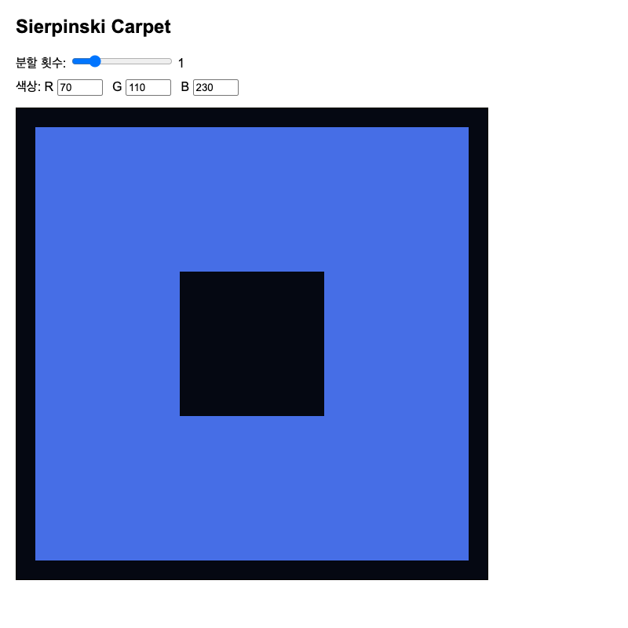
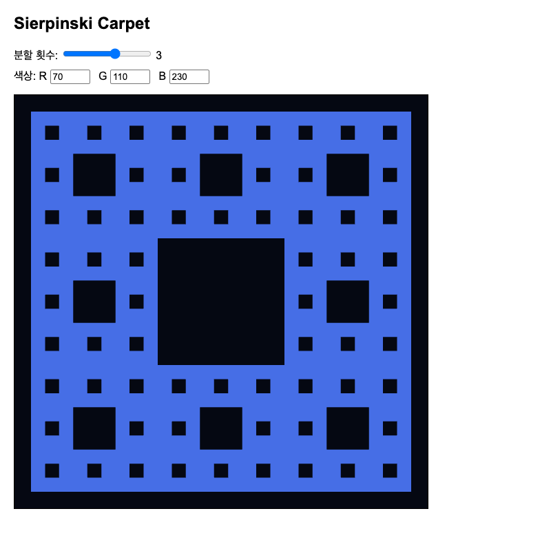
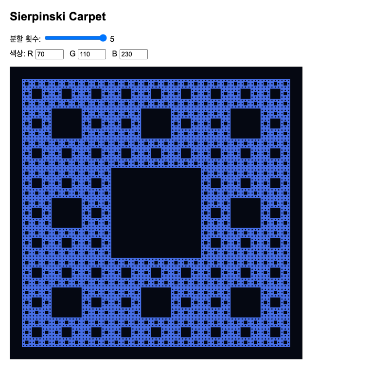
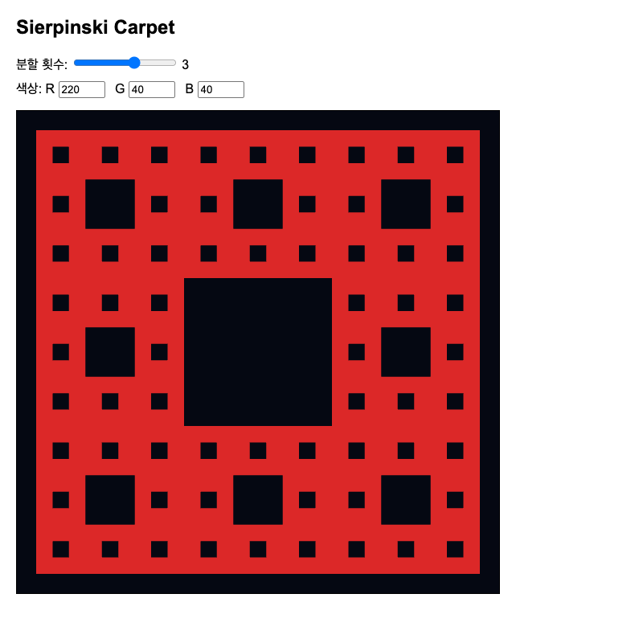

# WebGL을 이용한 Sierpinski Carpet 구현

## 1. 과제 개요

이 프로젝트는 WebGL과 재귀 알고리즘을 사용하여 Sierpinski Carpet을 생성한다. 사용자가 분할 횟수와 RGB 색상값을 변경하면 결과가 즉시 갱신되도록 구현하였다.

## 2. 이론적 배경

Sierpinski Carpet은 정사각형을 가로와 세로 방향으로 각각 3등분한 뒤, 가운데 정사각형을 제외한 8개의 정사각형에 같은 과정을 반복하여 생성하는 프랙탈이다. 분할 횟수가 `d`일 때 최종 사각형 수는 `8^d`이다.

WebGL은 정점 데이터를 GPU 버퍼에 저장하고, 정점 셰이더와 단편 셰이더를 사용하여 화면에 도형을 렌더링한다. 이 프로젝트에서는 정점 셰이더가 입력 좌표를 클립 좌표로 전달하고, 단편 셰이더가 uniform으로 받은 하나의 색상을 출력한다.

## 3. 설계

프로그램은 HTML, CSS, JavaScript로 구성하였다. HTML은 캔버스, 분할 횟수 슬라이더, R·G·B 입력 필드를 제공한다. JavaScript는 재귀적으로 정점을 생성하고 WebGL 버퍼에 업로드한다. GLSL 셰이더는 정점 위치와 최종 색상을 처리한다.

전체 처리 과정은 다음과 같다.

1. WebGL 컨텍스트를 생성한다.
2. 정점 셰이더와 단편 셰이더를 컴파일하고 연결한다.
3. 현재 분할 횟수에 따라 재귀적으로 최종 사각형을 구한다.
4. 사각형 하나를 두 개의 삼각형으로 변환하여 정점 배열에 추가한다.
5. 정점 배열을 `Float32Array`로 변환하여 GPU 버퍼에 업로드한다.
6. `gl.drawArrays`로 전체 삼각형을 렌더링한다.
7. 사용자 입력이 발생하면 필요한 데이터만 갱신하고 다시 렌더링한다.

## 4. 재귀 분할 구현

`divideSquare(x, y, size, depth)`는 현재 정사각형의 왼쪽 아래 좌표, 한 변의 길이, 남은 분할 횟수를 입력받는다. `depth`가 0이면 현재 정사각형을 최종 도형에 추가한다. 그렇지 않으면 한 변을 3등분하고, 행과 열이 모두 1인 가운데 영역을 제외한 8개 자식에 대해 함수를 다시 호출한다.

자식의 한 변과 왼쪽 아래 좌표는 다음과 같이 계산하였다.

```text
childSize = size / 3
childX = x + col × childSize
childY = y + row × childSize
```

각 재귀 호출에서 `depth`를 1씩 감소시켜 종료 조건에 도달하도록 하였다.

## 5. WebGL 렌더링

WebGL의 기본 요소로 삼각형을 사용하였다. 사각형 하나는 두 삼각형으로 나누며, 인덱스 버퍼를 사용하지 않는 구조이므로 사각형당 여섯 개의 정점을 저장한다. 생성된 일반 배열은 `Float32Array`로 변환한 뒤 `gl.bufferData`를 사용하여 GPU에 전달한다.

정점 셰이더는 `attribute vec2 aPosition`을 입력받아 `gl_Position`에 전달한다. 단편 셰이더는 `uniform vec4 uColor`를 받아 모든 단편에 같은 색상을 적용한다.

## 6. 사용자 입력

분할 횟수가 바뀌면 최종 사각형의 위치와 개수가 달라진다. 따라서 정점 배열을 다시 생성하고 GPU 버퍼를 갱신한다. 색상 변경은 정점 위치에 영향을 주지 않으므로 정점 데이터를 다시 만들지 않고 단편 셰이더의 uniform 값만 갱신한다.

R, G, B 입력값은 각각 0-255 범위로 제한한다. 각 값을 255로 나누어 WebGL에서 사용하는 0.0-1.0 범위로 변환한 뒤 단편 셰이더의 uniform으로 전달하였다.

## 7. 실행 결과 및 검증

| 분할 횟수 | 예상 사각형 수 | 예상 정점 수 |
|---:|---:|---:|
| 0 | 1 | 6 |
| 1 | 8 | 48 |
| 2 | 64 | 384 |
| 3 | 512 | 3,072 |
| 4 | 4,096 | 24,576 |
| 5 | 32,768 | 196,608 |

분할 횟수별로 생성된 정점 배열의 길이를 확인하여 위 계산과 일치하는지 검증하였다. 또한 분할 횟수 1, 3, 5의 실행 화면과 다른 RGB 값을 적용한 화면을 캡처하였다.

### 결과 이미지

분할 횟수 1에서는 가운데 영역이 제거된 8개의 사각형이 생성되었다.



분할 횟수 3에서는 512개의 사각형과 3,072개의 정점이 생성되었다.



분할 횟수 5에서는 32,768개의 사각형과 196,608개의 정점이 생성되었다.



R, G, B 입력값을 변경하면 기하 데이터는 유지되고 단편 셰이더의 uniform 색상만 변경되었다.



## 8. 문제점과 해결 과정

부모 정사각형의 한 변 길이와 좌표값을 처음에는 혼동하였다. 예를 들어 왼쪽 아래 좌표가 `(2, 5)`이고 한 변이 6인 정사각형의 오른쪽 위 좌표는 `(8, 11)`이다. 8과 11은 길이가 아니라 위치를 나타내는 좌표이며, 각 축의 좌표 차이가 6이다. 이를 바탕으로 자식 좌표를 부모의 시작 위치와 자식 크기의 배수로 계산하였다.

분할 횟수를 변경할 때 기존 정점 뒤에 새 정점이 누적되지 않도록 정점 배열을 먼저 초기화하였다. 또한 색상만 변경할 때는 불필요하게 기하 데이터를 다시 생성하지 않고 uniform만 갱신하였다.

## 9. 결론

재귀 분할을 통해 Sierpinski Carpet의 기하 데이터를 생성하고, 이를 WebGL 버퍼와 셰이더를 사용하여 렌더링하였다. 분할 횟수 변경은 기하 데이터를 재생성하고, 색상 변경은 uniform만 갱신하도록 역할을 분리하였다. 이를 통해 JavaScript에서 준비한 데이터가 GPU 버퍼와 셰이더를 거쳐 화면에 표시되는 WebGL의 기본 처리 과정을 확인하였다.

## 10. 소스 코드

GitHub 저장소: `https://github.com/stone0min/webgl-sierpinski-carpet`

## 11. AI 도구 사용

JavaScript의 배열, 함수, 반복문과 재귀 개념을 학습하고, Sierpinski Carpet의 좌표 계산 및 WebGL 렌더링 구조를 이해하기 위해 AI 도구를 사용하였다. 부모 정사각형의 위치와 길이 구분, 3×3 분할 시 자식 좌표 계산, 재귀 종료 조건, WebGL 버퍼와 셰이더의 역할에 관한 설명을 받았다. 또한 프로젝트의 초기 구조와 보고서 초안을 생성하는 데 도움을 받았다. 생성된 내용을 직접 실행하고 각 함수의 동작 및 결과를 검토한 뒤 수정하여 사용하였다.

## 12. 참고 자료

- 수업 자료: 컴퓨터 그래픽스 개요, 그래픽스 프로그래밍 1·2, 입력 및 상호 작용
- Edward Angel, Dave Shreiner, *Interactive Computer Graphics: A Top-Down Approach with WebGL*
